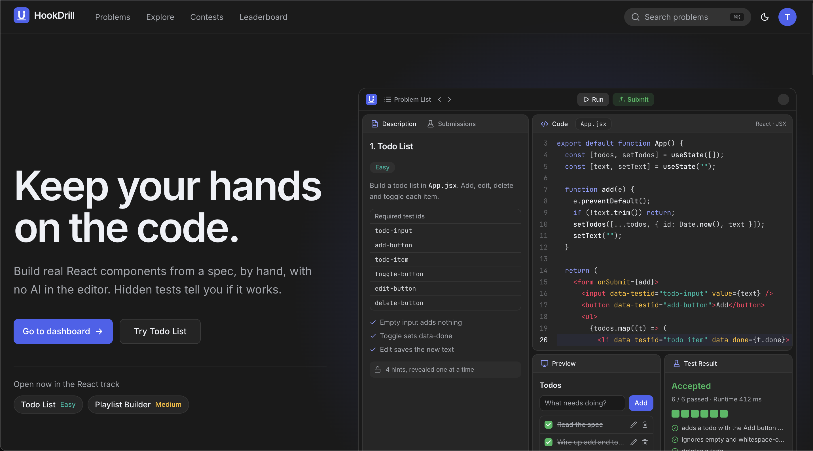

# HookDrill

Practice platform for keeping coding fundamentals sharp: React/UI problems you write by hand, without AI, with a live preview and hidden tests that check your code. Problems, a dashboard, contests and a leaderboard in the style of LeetCode, HackerRank and Codeforces, in light and dark mode.



The architecture is in [ARCHITECTURE.md](./ARCHITECTURE.md) and product context in [apps/web/PRODUCT.md](./apps/web/PRODUCT.md).

## Quick start

Requires Node 22+, pnpm (`packageManager` pins the version; `corepack enable` picks it up) and a local PostgreSQL database.

```bash
pnpm install
cp .env.example .env          # set DATABASE_URL and BETTER_AUTH_SECRET (openssl rand -base64 32)
pnpm db:migrate               # create tables
pnpm db:sync-challenges       # load challenge metadata
pnpm dev                      # web http://localhost:3000 + api http://localhost:3001
```

Sign in with GitHub once `GITHUB_CLIENT_ID`/`GITHUB_CLIENT_SECRET` are set (callback `http://localhost:3001/api/auth/callback/github`). Until then, the sign-in page shows a development-only email and password form; the API enables that only outside production.

## Scripts (repo root)

| Script                    | What it does                                                 |
| ------------------------- | ------------------------------------------------------------ |
| `pnpm dev`                | Web (port 3000, strict) and API (port 3001) with live reload |
| `pnpm build`              | Production build of the web app                              |
| `pnpm typecheck`          | TypeScript across web, api and db                            |
| `pnpm db:generate`        | Generate a migration after editing `packages/db/src/schema`  |
| `pnpm db:migrate`         | Apply migrations                                             |
| `pnpm db:sync-challenges` | Upsert challenge metadata from `packages/challenges`         |
| `pnpm challenge:new`      | Scaffold a new challenge from the template and register it   |
| `pnpm format`             | Format all files with Prettier                               |
| `pnpm format:check`       | Check formatting without writing (for CI)                    |

The Better Auth tables in `packages/db/src/schema/auth.ts` are generated: after changing the auth config in `apps/api/src/auth.ts`, run `pnpm dlx auth@1.7.12 generate --config apps/api/src/auth.ts --output packages/db/src/schema/auth.ts`, then `pnpm db:generate`.

## Stack

- pnpm workspaces monorepo
- [TanStack Start](https://tanstack.com/start) (React, TypeScript, file-based routing)
- Tailwind CSS v4 (`@tailwindcss/vite`) and shadcn/ui, themed with the DESIGN.md tokens
- API: Hono, tRPC (with superjson), Better Auth; PostgreSQL with Drizzle ORM (1.0 rc)
- [Sandpack](https://sandpack.codesandbox.io) for the editor, preview, and in-browser Jest test runner
- React Testing Library + `@testing-library/user-event` inside the sandbox
- Prettier

## Layout

```
apps/web/                      TanStack Start app (Vercel)
  src/routes/                  __root, _site/* (landing, problems, dashboard, …), problems.$slug (workspace)
  src/features/challenge-workspace/
                               the only place that imports Sandpack; persistence
                               comes in through props (drafts, runs, hints)
  src/components/              shared UI (header, test strip, heatmap, …); ui/ = shadcn/ui
  src/lib/                     tRPC client, Better Auth client, cn()
  src/client.tsx               client entry without StrictMode (see below)
apps/api/                      Hono + tRPC + Better Auth (VPS); exports type AppRouter
packages/db/                   Drizzle schema, migrations, sync-challenges script
packages/challenges/           challenge content, data only, no UI
  src/types.ts                 Challenge type (shared contract)
  src/catalog.ts               metadata only, safe outside Vite (API, DB sync)
  src/index.ts                 registry: listChallenges(), getChallenge(slug), getSolutionFiles(slug)
  src/react/<slug>/            meta, description.md, hints, starter/, solution/, tests/
  template/                    scaffold used by `pnpm challenge:new` (+ maintainer guide)
  scripts/new-challenge.mjs    the generator
```

## Adding a challenge

```bash
pnpm challenge:new          # asks for title, slug, difficulty, tags, summary
# or: pnpm challenge:new --title "Star Rating" --difficulty easy --tags "State, Events" --summary "..."
```

This copies `packages/challenges/template/` to `packages/challenges/src/react/<slug>/` and registers it in `src/catalog.ts` and `src/index.ts`. The scaffold is a working example (a counter) whose starter fails every test and whose solution passes every test. Replace it with your challenge, then:

1. `pnpm dev`, open `/problems/<slug>`: Run must fail every test; Load reference solution (sparkle button), Run must pass every test.
2. `pnpm db:sync-challenges`, then `pnpm typecheck && pnpm format`.

No UI code changes are needed. The full maintainer guide and checklist is in [packages/challenges/template/README.md](./packages/challenges/template/README.md).

### Writing tests: sandbox gotchas

Sandpack's in-browser Jest renders into a real DOM but exposes jsdom 16 globals. Follow the pattern in `todo-list/tests/todo.test.jsx`:

- Create user-event with `userEvent.setup({ document })`. Without it, typing silently does nothing or throws `The provided value is not of type 'Element'`.
- Query inside the rendered container (`within(container)`), not `screen`.
- Stick to plain `expect` matchers; `jest-dom` is untested here.
- Contract with the user is `data-testid` selectors; list every one in `description.md`.

## Known limitations

- Hidden tests are hidden from the editor only; they are sent to the browser and readable in DevTools. Pass/fail is computed client-side.
- Reference solutions are excluded from production builds (dev-only loader).
- Code runs on CodeSandbox's hosted bundler and npm CDNs, so a network connection is required.
- React StrictMode is disabled app-wide (`apps/web/src/client.tsx`) because it breaks Sandpack's client registration.

See [SPIKE_REPORT.md](./SPIKE_REPORT.md) for details, risks, and next steps.
